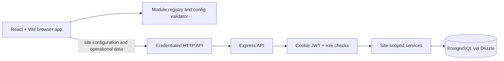

# OpsHub architecture

## System overview

## Frontend

`frontend/` is a React 18 and Vite app. `src/lib/registry.js` defines the 13 supported module types, typed inputs/outputs, defaults, presets, page metadata, and configuration validation. The builder stores nodes and edges as JSON configuration. `src/pages/SiteRoute.jsx` renders pages from the active site's enabled modules, so a site slug does not determine its features. View components are under `src/views/`; API clients are under `src/api/` and `src/lib/`.

The frontend uses the HTTP API for login/session, site discovery/configuration, and operational data. No browser-local simulator or demo operational records are included.

## Backend

`backend/src/server.js` hosts the Express 5 API. It configures Helmet, credentialed CORS, cookie parsing, JSON parsing, health/readiness handlers, module routers, 404 handling, and centralized errors. Routes call controllers and services; services access PostgreSQL through Drizzle. Authentication uses a server-issued JWT in an HttpOnly cookie. Business operations check site membership/role and scope database queries using the site UUID.

`GET /health` checks that the process responds. `GET /ready` also queries PostgreSQL. The service defaults to port 3000.

## Configuration and modules

The registry contains 13 modules: Authentication & RBAC, User Management, Dashboard Shell, Inventory, Request, Approval, Material Assignment, Assignment Frontend, Consumption Tracking, Return Management, PCB Repair, Analytics Dashboard, and Reports/Excel. A configuration includes module nodes and typed edges, plus site theme/page settings. The backend validates and versions draft/published configuration; the frontend registry remains the source for module semantics. Keep module definitions and validators aligned when changing configuration behavior.

## Data and tenancy

The canonical schema is in `backend/src/db/schema/`; migrations are in `backend/drizzle/`. Site-owned records include a `site_id`; same-site composite foreign keys constrain references between business records. Service queries also scope records to the requested site and authenticated membership.

PostgreSQL RLS policies are not currently installed. Same-site constraints and API checks reduce accidental cross-site access but do not provide database-enforced isolation against a future query bug. Real database isolation tests are also pending. Review [data-model.md](data-model.md) and [features.md](../features.md).

## Security and deployment boundaries

- The browser receives an HttpOnly JWT cookie; API calls use credentials. Do not place passwords, JWT secrets, or database URLs in frontend variables.
- Set a random `JWT_SECRET`, exact allowed frontend origins in `CORS_ORIGINS`, and secure cookie settings appropriate for the deployment. Cross-site cookies require HTTPS and `AUTH_COOKIE_SAME_SITE=none`.
- Configure a database backup and migration process before using real operational data.
- The API currently has no RLS policy layer, real backend test suite, or deployment manifests.
- Vite history routing requires the production web server to serve `index.html` for application routes.

## Change flow

1. Update module types/defaults/validation in `frontend/src/lib/registry.js` when changing site configuration behavior.
2. Update backend schema files and generate/apply a migration for persisted data changes.
3. Update services/controllers and `docs/api.md` when an API behavior changes.
4. Keep backend seed data and workflow documentation consistent with the schema and registry.
