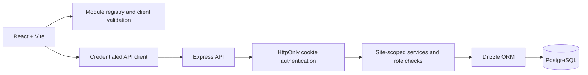

# Architecture

OpsHub is a configuration-driven, multi-site operations application. One React client renders site-specific navigation and views from saved configuration. The backend provides authentication, configuration lifecycle APIs, operational services, and PostgreSQL persistence.

## Request path

## Frontend

`frontend/` is a React 18 application built with Vite. Shared UI lives in `frontend/src/`; API clients are in `frontend/src/api/` and use the configured Axios client. The frontend has no browser-local operational database or simulator.

The module registry in `frontend/src/lib/registry.js` is the client-side source of truth for 13 approved module types, their typed inputs and outputs, defaults, presets, page metadata, and configuration validation. The React Flow builder edits module nodes, edges, fields, approval steps, and theme; it saves drafts and exposes preview, publish, release history, and rollback. `frontend/src/pages/SiteRoute.jsx` resolves rendered pages from the active published configuration rather than from site slugs.

Operational views under `frontend/src/views/` load and mutate API-backed resources. React Query is used for remote reads and cache invalidation. Site context includes the current site, published configuration, user role, and theme.

## Backend

`backend/src/server.js` starts an Express 5 API (default port 3000). The app configures Helmet, credentialed CORS, cookie parsing, JSON/urlencoded parsers, health/readiness routes, resource routers, 404 responses, and centralized error handling.

Authentication uses a server-issued JWT in an HttpOnly cookie named `token`, scoped to `/api`. Authenticated operations resolve the active account from the database. Site services verify membership or global-administrator status, check enabled modules and operation-specific roles, and use site identifiers in business-data queries.

Routes call controllers, which call services. Services use Drizzle ORM against PostgreSQL. `GET /health` checks process liveness; `GET /ready` also issues a database query.

## Configuration and modules

The approved module catalog is Authentication & RBAC, User Management, Dashboard Shell, Inventory, Request, Approval, Material Assignment, Assignment Frontend, Consumption Tracking, Return Management, PCB Repair, Analytics Dashboard, and Reports/Excel.

A site configuration contains module nodes and typed edges, along with theme and page presentation settings. The frontend registry validates the 13 module types and connection semantics. The backend validates saved configuration and stores drafts separately from published versions. Publishing creates a version and deployment record; rollback publishes a selected previous configuration as a new deployment action.

The database also has a normalized module catalog and site-module enablement records. The published JSON configuration is the runtime source used by the site renderer and services.

## Data and tenant boundaries

Drizzle schema definitions live in `backend/src/db/schema/`; SQL migrations live in `backend/drizzle/`. Site-owned business tables include `site_id`. Selected foreign keys are composite on site and referenced record, preventing cross-site references for those relationships. Services also scope queries by site and require site membership/role where appropriate.

**PostgreSQL row-level security is not installed.** Direct database access and an accidentally unscoped query are not contained by RLS. The current controls are API/service checks and selected same-site constraints; do not describe them as complete database-enforced tenant isolation. Cross-site integration tests are also outstanding. See [the data model](data-model.md) and [feature checklist](../features.md).

## Authentication and deployment considerations

- Never put database URLs, JWT secrets, or passwords in frontend environment variables.
- Configure a high-entropy `JWT_SECRET`, exact allowed origins in `CORS_ORIGINS`, and production cookie settings.
- Cross-site cookies require HTTPS and `AUTH_COOKIE_SAME_SITE=none`; the cookie is then marked secure by the backend.
- Configure backups, secret management, HTTPS, and a migration process before handling production data.
- A production frontend host must serve `index.html` for client-side routes. Configure the frontend API URL at build time when not using the local default.
- The repository does not provide a deployed production stack or end-to-end environment.

## Change flow

1. Update `frontend/src/lib/registry.js` when changing module semantics, typed connections, presets, or client validation.
2. Update Drizzle schema files and generate/review/apply a migration when persisted data changes.
3. Update backend service/controller behavior and [the API reference](api.md) when routes or payloads change.
4. Keep the seed data, [workflow guide](workflows.md), and [data model](data-model.md) aligned with implementation.
5. Update [feature status](../features.md) when delivery state or known gaps change.
