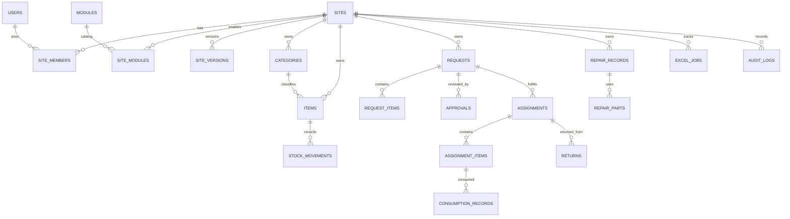

# Data model

The canonical schema is implemented as Drizzle definitions in `backend/src/db/schema/` and versioned SQL in `backend/drizzle/`. Do not use `frontend/docs/schema.sql` as a database migration; it only points to the backend source.

## Entity map

## Tables by purpose

| Area | Tables | Purpose |
|---|---|---|
| Identity and site config | `users`, `sites`, `site_members`, `modules`, `site_modules`, `site_versions`, `deployments` | Accounts, global/site roles, module catalog and enabled configuration, draft/published versions and deployment history. |
| Inventory | `categories`, `items`, `stock_movements` | Site-owned catalog and on-hand quantities with a movement ledger. |
| Request workflow | `requests`, `request_items`, `approvals` | User requests, requested lines, and approval history/decisions. |
| Fulfillment | `assignments`, `assignment_items`, `consumption_records`, `returns` | Issued stock, quantities consumed, and material/device returns. |
| Repair | `repair_records`, `repair_parts` | Repair lifecycle and associated components/cost data. |
| Reporting and trace | `excel_jobs`, `audit_logs` | Workbook/import job information and audit events. |

Column names, PostgreSQL types, indexes, enum values, and constraints are authoritative in schema source files. A concise schema inventory is available at `backend/src/db/schema/index.js`.

## Site scoping

Business records carry a `site_id`. Service queries include the site ID and membership/role checks. Composite foreign keys are used for selected relationships to ensure that a referenced record belongs to the same site. Site configuration is stored as JSON and versioned separately from operational records.

RLS policies are not implemented. A direct database client can bypass Express role checks, and a future unscoped service query could expose records. RLS and cross-site database integration tests are known delivery gaps.

## Configuration versus operational records

The module registry/configuration controls which pages and features a site presents. Operational tables store normalized records used by those modules. Configurable form fields do not dynamically create PostgreSQL columns; their values are persisted in the record JSON fields where supported by the service. The registry and service validation must remain compatible.
