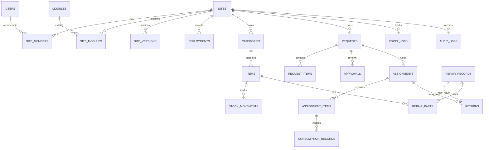

# Data model

The canonical PostgreSQL schema is defined with Drizzle in `backend/src/db/schema/`; versioned SQL migrations are in `backend/drizzle/`. The schema source and migrations are authoritative. `frontend/docs/schema.sql` is not a standalone migration.

## Entity overview

The diagram summarizes key relationships; inspect the Drizzle definitions for nullable links, delete behavior, unique constraints, and composite foreign keys.

## Tables by domain

| Domain | Tables | Purpose |
|---|---|---|
| Accounts and access | `users`, `site_members` | Global accounts and site-specific roles. |
| Sites and configuration | `sites`, `modules`, `site_modules`, `site_versions`, `deployments` | Site metadata, module catalog/enablement, draft and published configuration, release history. |
| Inventory | `categories`, `items`, `stock_movements` | Site-owned categories and SKUs, on-hand balances, and stock movement history. |
| Requests and approvals | `requests`, `request_items`, `approvals` | Configurable requests, requested inventory lines, and decision history by step. |
| Fulfillment and tracking | `assignments`, `assignment_items`, `consumption_records`, `returns`, `return_items` | Issued quantities, remaining quantities, consumption, and material/device returns. |
| Repair | `repair_records`, `repair_parts` | Repair intake, stage, costs, technician, and parts. |
| Reporting and audit | `excel_jobs`, `audit_logs` | Import/export job records and audit events. |

`backend/src/db/schema/index.js` re-exports schema modules. Enum values, column types, indexes, checks, and defaults are defined in the neighboring schema files.

## Site ownership and constraints

Business tables are associated with a site. Selected relationships use composite foreign keys that include `site_id`, such as an item's category, a request's item lines, assignment item references, repair parts, and a site's current version. This prevents those references from crossing sites at the database constraint level.

Service queries also filter by site and resolve the authenticated user's site membership/role. This is not complete database isolation: **RLS policies have not been installed**. A direct SQL client bypasses API checks, and any future unscoped service query remains a risk. Cross-site API/database integration coverage is outstanding.

## Configuration versus operational data

The module registry defines approved module types, defaults, page metadata, typed connections, and configurable fields. A site's draft and published configurations are JSON stored on site/version records; publishing records version and deployment history.

Operational data uses normalized tables for core relationships. Configurable form values are stored in record JSON metadata where the service supports them; they do not create PostgreSQL columns dynamically. Keep module configuration validation, service field cleaning, and schema behavior aligned.

## Data lifecycle

- A request may have configured fields and zero or more normalized `request_items`.
- Approval decisions are append-style history records tied to the request and configured step.
- Assignment creation links approved/open request work to inventory and records an issue movement transactionally.
- Consumption reduces `assignment_items.remaining_quantity` and creates a `consumption_records` row.
- Return records and lines retain references to the source assignment or repair and record condition/resolution details.
- Repair parts can link a repair record to inventory items; repair stage and status are separate database enums.
